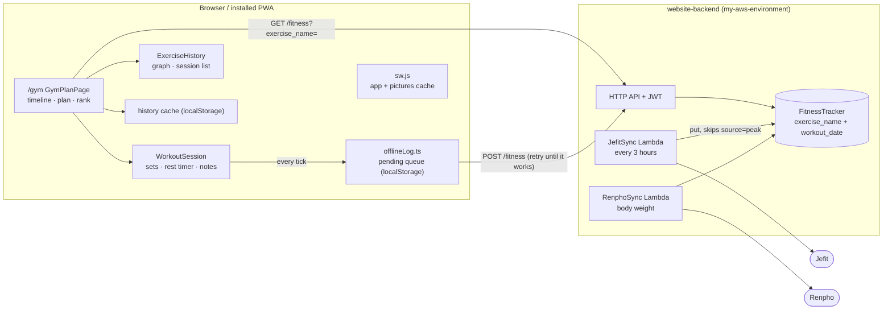

# Gym app ("Peak") at sahangamage.click/gym

Read this first when working on `/gym`. It is the map of how the training app fits together.
Backend resources (API, Lambdas, DynamoDB) live in the other repo: `my-aws-environment/README.md`.

## What it is

A personal training app (owner only for now; multi-user is planned, see the direction note in memory).
It shows the next session from a rule-based powerbuilding plan, lets you log the workout in the app
(Jefit-style, works offline), and charts history. It is an installed web app (PWA) on the owner's phone.

## Data flow

## Files

| File | Job |
|---|---|
| `src/app/pages/GymPlanPage.tsx` | The page: session timeline, the plan for the selected session, rank card, Start workout bar. |
| `src/app/lib/gymPlan.ts` | All plan logic and the routine itself (`getPowerbuildingRoutine`). Read its header comment for the progression rules. |
| `src/app/components/WorkoutSession.tsx` | Logging screen: swipe pager, set rows, rest timer, session clock, plates, notes. |
| `src/app/lib/offlineLog.ts` | Queue + sync + `buildPayload` (turns entered sets into a cloud row). |
| `src/app/components/ExerciseHistory.tsx` | Graph (1RM, volume, x bodyweight), ranges, tier ladder, every past session. |
| `src/app/components/ExerciseNotes.tsx` | Past notes list. |
| `src/app/lib/strengthStandards.ts` | Bodyweight-ratio tiers (Beginner to Elite). Approximate numbers; edit freely. |
| `src/app/lib/exerciseMedia.ts` | Exercise pictures (public domain, `public/exercises/`), muscle, and display names. |
| `src/app/pages/GymPage.tsx` | The old tracker at `/gym/tracker`. Separate, kept for now. |
| `public/sw.js`, `public/manifest.json` | Offline caching and install metadata (scope `/gym/`). |

## The one cloud row

`FitnessTracker` has **one row per exercise per day** (key: `exercise_name` + `workout_date`).
A row holds: `raw_logs` (`"kgxreps,kgxreps"`, always **kg**), `set_types` (same length: `warm-up`,
`default`, `drop`, `failure`), `one_rep_max_kg/lbs`, `total_volume_lbs`, optional `notes`, and `source`
(`jefit`, `peak`, or none for old rows). The plan works in **lb**; the conversion happens when reading
(`parseSets`) and writing (`buildPayload`).

- Logging the same exercise in two sessions on one day shares one row. `WorkoutSession` keeps earlier sets
  as `base` and appends to them without altering their stored values.
- The Jefit sync replaces rows it owns but skips `source = peak`.
- Pull-ups are stored as **total load** (body + added). The logging screen shows added weight.
- `POST /fitness` is owner-only and replaces the whole row, so retrying is safe. Notes need the `notes` field
  (backend change applied 2026-11).
- No delete route: unticking every set does not remove a row already saved.

## How the plan decides things

- **Plan start** is `PLAN_START` in `gymPlan.ts`. Week 1 is the calendar week (Mon to Sun) containing it.
- **Which day a session was** is inferred, not stored: `assignedSessions()` looks at main lifts per date
  (bench = Day 1/4, squat + pull-up = Day 2/5, accessory-day lifts = Day 3). `nextDayIndex` follows from it.
- **Main lifts** (bench, squat, weighted pull-up): top set + back-offs on a 4-week wave; estimated max replayed
  from history; deload every 4th cycle or after two misses. **Accessories**: double progression, 8-12 reps.
  Barbell accessories snap to 5 lb. Back-offs never drive progression; the top set does.
- **The timeline** (`SessionStrip`) is: logged sessions since the plan started, then the next sessions. Sessions
  still due this calendar week use this week's numbers; later ones use the +1 week projection (the plan can
  only project one week ahead).
- Swaps: either/or exercises are defined in `ALTERNATIVE_PAIRS` (`gymPlan.ts`); the page opens on the one done
  most recently.

## Offline behaviour

- Every tick is saved to `localStorage` and queued (`peak_pending_logs`); it is sent immediately when online and
  retried on reconnect and every 30 seconds. The header and workout bar show the sync state.
- An unfinished workout is kept in `peak_active_session` (version 2, today only). "Resume" appears only when
  it has a ticked set.
- Last good history per exercise is kept in `peak_history_cache`, and `sw.js` caches the app shell and pictures,
  so `/gym` opens with no signal (after one online visit).

## Gotchas

- **New routes need a build copy.** It is a single-page app on GitHub Pages: `npm run build` copies
  `dist/index.html` into each route folder (`dist/gym/`, `dist/gym/tracker/`, ...). Add new URLs to that script.
- **Owner check is client-side too:** `isAdmin` compares the token's `sub` with `VITE_OWNER_SUB`. The real
  enforcement is the API (`isOwner`).
- **Global CSS fights Tailwind in places.** `section`, `h1`/`h2` get margins and `button` colours from global
  styles. Use `div` or inline style when a utility class does not apply.
- **Never put `overscroll-behavior` on `body`** (only `html`): `body` is a scroll container here and it blocks
  touch scrolling.
- Exercise names are keys into history. Renaming one in code splits its history; use `displayName` in
  `exerciseMedia.ts` to change what is shown.
- Pictures: two frames per exercise from free-exercise-db. The single-arm triceps press machine has no picture.

## Deploy

Push to `main` deploys via GitHub Pages (`.github/workflows/pages-deploy.yml`). Frontend PRs can be merged after
review. Backend changes go through `my-aws-environment` (branch, PR, CI plan, merge, CI applies).
