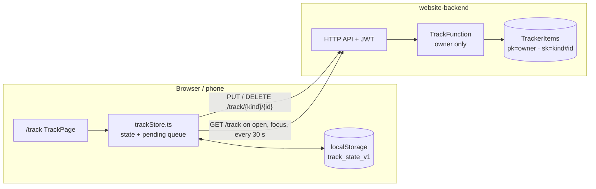

# Time tracker at sahangamage.click/track

Read this first when working on `/track`. Owner only (signed-out visitors go to `/login?next=/track`).
Backend resources live in `my-aws-environment/terraform/website-backend` (`TrackerItems` table, `TrackFunction`).

## What it is

Tasks with points, a calendar, and a timer, all tagged Work / Learning / Personal. Time adds up per activity
(a linked task, or a typed label). Switching activity while the timer runs saves the old stretch and starts the new one.
Optional focus blocks (15 to 90 min) alert you when a block ends while the clock keeps counting; the alert offers a break.
Tap a task's "+pts" badge to edit its points, even after it is done.
Corner mode shrinks the page to just the timer.
It installs as an app (Chrome/Edge: Install button in the card or the address bar icon): `public/track_manifest.json`, scope `/track/`, service worker `sw.js` registered from `RootLayout.tsx`.

## Data flow

## How sync works

- One cloud item per task, time entry, the running timer (`timer#active`) and settings (`settings#main`).
- Every change is saved locally first, queued, and sent (retried until it works).
- Last write wins per item, compared by `updatedAt`. A delete leaves a tombstone so an old copy cannot bring the item back.
- The running timer is an item, so a timer started on the laptop shows on the phone after the next sync.
- Not covered: two devices both open when a focus block ends can each count it and alert.

## Files

| File | Job |
|---|---|
| `src/app/pages/TrackPage.tsx` | The page: timer card, tasks, calendar, stats, focus blocks and alerts. |
| `src/app/lib/trackStore.ts` | State, localStorage copy, sync queue and merge. |
| `src/apiService.js` | `fetchTrack`, `putTrack`, `deleteTrack`. |
