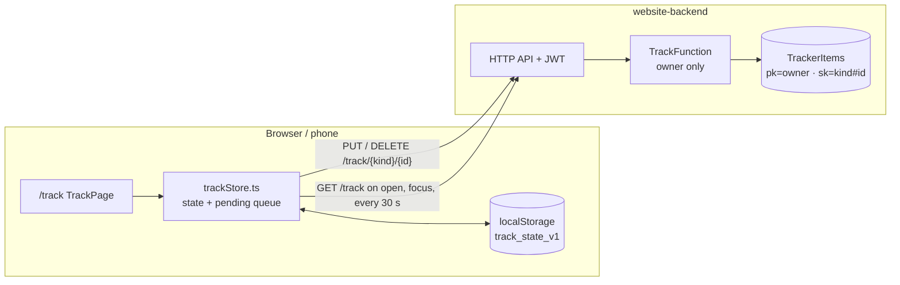

# Time tracker at sahangamage.click/track

Read this first when working on `/track`. Owner only (signed-out visitors go to `/login?next=/track`).
Backend resources live in `my-aws-environment/terraform/website-backend` (`TrackerItems` table, `TrackFunction`).

## What it is

Tasks with points, a calendar, and a timer, all tagged Work / Learning / Personal. Time adds up per activity
(a linked task, or a typed label). Switching activity while the timer runs saves the old stretch and starts the new one.
Optional focus blocks (15 to 90 min) alert you when a block ends while the clock keeps counting; the alert offers a break.
If no alert button is clicked, it nags again at +1 and +2 min (louder each time) and stops tracking at +3 min, saving time only up to the block end (page must be open).
Tasks can have no due date (shown as "No due date", not on the calendar). Level points = 1 per 10 min tracked; completing a task adds none.
Board tab: sticky-note cards in swim lanes (default Ideas / Next up / Doing / Done; rename, add, delete lanes). Drag a card by its grip to reorder or move lanes (animated with `motion`).
"To tasks" on a card creates a no-due-date task linked to it; the card then shows "On task list" / "Task done". Deleting a card keeps its task.
Every task also gets a board card (id `c_<taskId>`, made by `adoptTasks` when the Board opens: open -> Next up, done -> Done). Deleting a task deletes that card; deleting a card keeps the task.
**Epic model.** An epic is a board card with `epic: true` and no task of its own. It lives only on the Board; the Tasks page shows it just as the chip on its subtasks. Its own time is logged against the card id, its due date and done flag live on the card (`card.due`, `card.done`). `convertToEpic` (task card -> epic, also the Layers button on a Tasks-page row via `convertTaskToEpic`) removes the task and moves its time to the card; `convertToTask` creates a task again and turns every subtask into a free task with its own card. Old data where an epic still had a task is normalised by `migrateSubs`.
Done: dragging a card into the Done lane completes it (a task, or an epic and all its subtasks); dragging out reopens it. The epic checkbox does the same. Dropping a plain card on an epic makes it a subtask (`moveIntoEpic`); the unlink icon on a subtask frees it (`detachSubtask`). Cards have a Track button: time goes to the linked task, or to the card id when there is no task, and an epic's total includes its subtasks' tasks.
A task ticked off on the phone widget (which cannot move cards) is settled when the Board opens: `settleDoneTasks` moves its card to Done if the task was completed after the card was last touched.
Category can be changed after creation: click the category on a task row, a board card's dot, or an activity's dot in Stats (`setActivityCat`: changes the task, its cards and all its time entries, so Stats follow); a dot on a Calendar time entry changes just that entry.
Accidental time: a stretch under 30 s is not saved (`MIN_ENTRY_MS`), Stats lists only activities of a minute or more, deleting a task also deletes its entries if they total under a minute (real time is kept), and `pruneTinyEntries` removes old sub-30 s entries after the first sync of a session.
Names are shared: click a task title (Tasks, Calendar), a board card, an epic or a subtask to rename. `renameTask` / `renameCard` keep the task, its card, epic subtasks and (for cards tracked on their own) time entries in step; a card's first line is the task title.
Safety: a blank name is never saved (editing a card and leaving it blank restores the old name; it used to delete the card). Deleting a card shows an Undo bar for 12 s; deleting a task with a minute or more of tracked time asks first.
Points: they come from tracked time only (1 per 10 min); a task row shows its own `+N` (not editable, `task.pts` is unused).
Tab changes fade (`goTab`: fade out, swap `view` after 140 ms, fade in; content is never unmounted mid-fade, so fast clicks cannot leave it blank). Ticking a task done (`toggleTaskDone`) moves its card to the top of Done; reopening moves it to Next up. Going to Board collapses the left column (width animation on `motion.aside`, content fixed at 360px inside) while the right card grows with flex; the new content fades in after a delay so it never shows mid-resize.
Epics look rich (tint, thick edge, bold title); plain cards are quiet. Due date is editable on any card: it is the linked task's due, or `card.due` when there is no task.
**Subtasks are tasks.** A subtask is a normal task with `epicId` set to its epic card (and `ord` for its order). It shows on the Tasks page and Calendar like any task (with an epic chip) and inside its epic on the Board, where you can tick, rename, set category and due date, track time, or delete it. Adding a subtask on the Board creates the task. Old in-card `subs` are converted by `migrateSubs()` (same ids on every device). Subtasks do not get their own board card (`adoptTasks` skips tasks whose epic card exists).
Time: an epic card shows its own time plus its subtasks' (each entry counted once, `Set` of ids). Stats sums entries, so nothing is double counted; subtask rows read "Epic › Subtask".
Ticking a task done while the timer is on it (running or paused) stops the timer and saves the time to it (`toggleDone` in TrackPage; also used for subtask ticks on the Board).
Stats opens on Today; presets 7/14/30 days or a custom from/to range.
Tap a task's "+pts" badge to edit its points, even after it is done.
Corner mode shrinks the page to just the timer.
**Outings (time away from home).** The phone app (`track-android`: home geofence, plus a Google Timeline import) sends `outing` items `{start, end, source: 'geofence' | 'timeline', status: 'new'}` (id `o<start minute in base 36>`, so the same trip is never added twice). The Tasks tab shows `status: 'new'` outings in an "Outings" inbox (`OutingsInbox`): **Add** puts the stretch on a chosen open task as a time entry, **Make errand** creates a Personal task and logs the stretch on it, X dismisses. Either way the outing becomes `used` / `dismissed` and leaves the inbox. Stretches under 30 s are hidden. Location itself never reaches the server: only start and end times do. Backend kind `outing` in `TRACK_KINDS` (`terraform/website-backend/src/index.js`).
**Layout (app shell).** `/track` is one viewport tall (`.track-shell` in `RootLayout.tsx`: `100dvh`, safe-area padding, `html.track-route` has no page scroll and no overscroll bounce). From 1024px up, only panes scroll: the left column (`aside`, scrolls alone if taller than the window) and the tab content (Tasks / Calendar / Stats), so the timer never moves. The Board has one scroller (`.board-scroll`, a `motion.div layoutScroll`) holding all lanes; each lane's "Jot something…" is `sticky bottom-0`, so it stays at the bottom of the window however long the lane is. Lanes are deliberately not scroll containers themselves: an inner `overflow` would clip a dragged card and break the drop hit-testing (`laneAt`, `epicAt`). Below 1024px the layout is stacked and `.track-app` scrolls as one column. Native-feel CSS (thin themed scrollbars, no tap highlight, no text selection on chrome but yes on inputs and cards, `overscroll-behavior`) lives at the end of `src/styles/theme.css`. The board's horizontal scrollbar is hidden (webkit only) so no bar sits along the bottom edge.
It installs as an app (Chrome/Edge: Install button in the card or the address bar icon): `public/track_manifest.json`, scope `/track/`, service worker `sw.js` registered from `RootLayout.tsx`.

## Data flow

## How sync works

- One cloud item per task, board card (`card#id`; lanes live in `settings#main`), time entry, the running timer (`timer#active`) and settings (`settings#main`).
- Every change is saved locally first, queued, and sent (retried until it works).
- Last write wins per item, compared by `updatedAt`. A delete leaves a tombstone so an old copy cannot bring the item back.
- The running timer is an item, so a timer started on the laptop shows on the phone after the next sync.
- Not covered: two devices both open when a focus block ends can each count it and alert.

## Files

| File | Job |
|---|---|
| `src/app/pages/TrackPage.tsx` | The page: timer card, tasks, calendar, stats, focus blocks and alerts. |
| `src/app/pages/TrackBoard.tsx` | The Board tab: lanes, cards, drag and drop. |
| `src/app/lib/trackStore.ts` | State, localStorage copy, sync queue and merge. |
| `src/apiService.js` | `fetchTrack`, `putTrack`, `deleteTrack`. |
