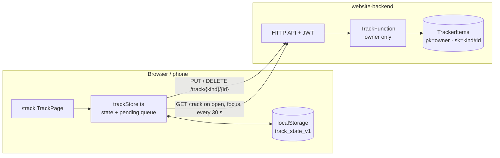

# Time tracker at sahangamage.click/track

Read this first when working on `/track`. Owner only (signed-out visitors go to `/login?next=/track`).
Backend resources live in `my-aws-environment/terraform/website-backend` (`TrackerItems` table, `TrackFunction`).

## What it is

Tasks with points, a calendar, and a timer, all tagged Work / Learning / Personal. Time adds up per activity
(a linked task, or a typed label). Switching activity while the timer runs saves the old stretch and starts the new one.
Optional focus blocks (15 to 90 min) alert you when a block ends while the clock keeps counting; the alert offers a break.
If no alert button is clicked, it nags again at +1 and +2 min (louder each time) and stops tracking at +3 min, saving time only up to the block end (page must be open).
Tasks can have no due date (shown as "No due date", not on the calendar). Level points = 1 per 10 min tracked; completing a task adds none.
Board tab: sticky-note cards in swim lanes (default Ideas / Next up / Doing / Done; rename, add, delete lanes). Drag a card by its grip to reorder or move lanes (animated with `motion`).
"To tasks" on a card creates a no-due-date task linked to it; the card then shows "On task list" / "Task done". Deleting a card keeps its task.
Every task also gets a board card (id `c_<taskId>`, made by `adoptTasks` when the Board opens: open -> Next up, done -> Done). Deleting a task deletes that card; deleting a card keeps the task.
"-> Epic" / "Epic" on a card converts it to an epic and back (the flag is `card.epic`; subtasks are kept when converting back). Cards have a Track button: time goes to the linked task, or to the card id itself when there is no task, and an epic's total includes its subtasks' tasks.
Tab changes fade (`goTab`: fade out, swap `view` after 140 ms, fade in; content is never unmounted mid-fade, so fast clicks cannot leave it blank). Ticking a task done (`toggleTaskDone`) moves its card to the top of Done; reopening moves it to Next up. Going to Board collapses the left column (width animation on `motion.aside`, content fixed at 360px inside) while the right card grows with flex; the new content fades in after a delay so it never shows mid-resize.
Epics look rich (tint, thick edge, bold title); plain cards are quiet. Due date is editable on any card: it is the linked task's due, or `card.due` when there is no task.
A card that is an epic holds subtasks: progress bar and n/total on the card, expand to tick, add or delete them. A subtask's list icon puts it on the task list; after that the task decides whether it is done.
Stats opens on Today; presets 7/14/30 days or a custom from/to range.
Tap a task's "+pts" badge to edit its points, even after it is done.
Corner mode shrinks the page to just the timer.
It installs as an app (Chrome/Edge: Install button in the card or the address bar icon): `public/track_manifest.json`, scope `/track/`, service worker `sw.js` registered from `RootLayout.tsx`.

## Data flow

## How sync works

- One cloud item per task, board card (`card#id`; lanes live in `settings#main`), time entry, the running timer (`timer#active`) and settings (`settings#main`).
- Every change is saved locally first, queued, and sent (retried until it works).
- Last write wins per item, compared by `updatedAt`. A delete leaves a tombstone so an old copy cannot bring the item back.
- The running timer is an item, so a timer started on the laptop shows on the phone after the next sync.
- Not covered: two devices both open when a focus block ends can each count it and alert.

## Files

| File | Job |
|---|---|
| `src/app/pages/TrackPage.tsx` | The page: timer card, tasks, calendar, stats, focus blocks and alerts. |
| `src/app/pages/TrackBoard.tsx` | The Board tab: lanes, cards, drag and drop. |
| `src/app/lib/trackStore.ts` | State, localStorage copy, sync queue and merge. |
| `src/apiService.js` | `fetchTrack`, `putTrack`, `deleteTrack`. |
